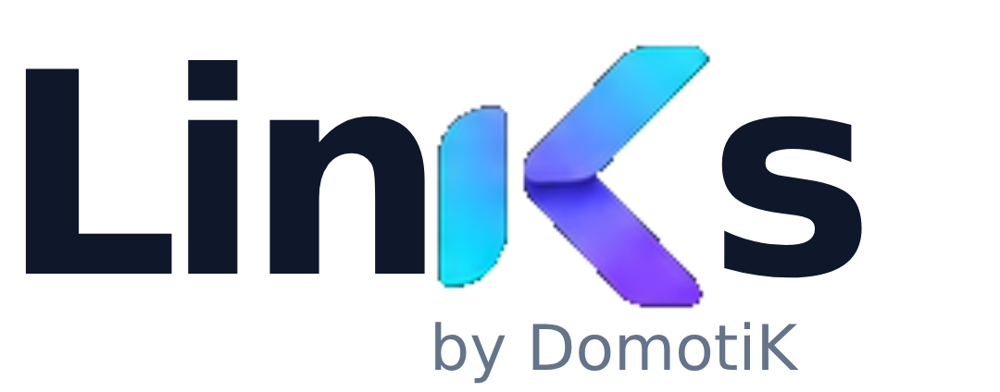

# LinKs · by DomotiK

<picture>
  <source media="(prefers-color-scheme: dark)" srcset="docs/assets/links-logo-dark.png">
  <source media="(prefers-color-scheme: light)" srcset="docs/assets/links-logo-light.png">
  
</picture>

LinKs est une page de liens auto-hébergée, personnalisable et accompagnée d’un back office. Elle réunit les liens, réseaux sociaux et offres d’un créateur, d’un projet ou d’une communauté sur une page adaptée aux ordinateurs et aux mobiles.

## Fonctionnalités

### Page publique

- Liens et boutons de réseaux sociaux organisables.
- Dernière vidéo facultative lorsqu’une source est configurée.
- Cartes de campagnes illustrées, carrousel et copie de codes promo.
- Citation facultative dans le footer.
- Identité, images et copyright personnalisables.

### Campagnes

- Programmation avec dates et heures dans le fuseau choisi.
- Activation, brouillons, priorités et ordre manuel.
- Jusqu’à trois offres simultanées, contrôle des chevauchements et proposition de créneau.
- Duplication, archives et liens directs pour les Stories.

### Liens suivis

- Bibliothèque indépendante sans catégories de liens : nom obligatoire, recherche par nom/destination/notes, filtre d'état, création/édition, copie et ouverture des destinations.
- Partenaires facultatifs avec modèles libres, détection par domaine et aperçu de l’URL finale. Les URL affiliées directes restent utilisables sans configuration.
- Destinations publiées conservées jusqu’à confirmation explicite ; URL d’origine et associations sauvegardées.
- Détection des doublons après tracking, réutilisation des liens courts et ajout de sources au même lien.
- Suivi privilégié par plateforme (Instagram, YouTube, Discord, Facebook, TikTok). Les anciennes variantes restent accessibles dans les groupes et filtres historiques, sans fusion de leurs identifiants ni de leurs compteurs.
- PulSe conserve la récupération des liens et les URL de ses Stories déjà partagées.

### Statistiques

- Une seule page, organisée en vue globale, liens suivis, page publique et campagnes, avec six indicateurs distincts.
- Visites, clics publics, ouvertures des liens suivis, ouvertures des campagnes, impressions, CTR et copies de codes conservés séparément.
- Courbes d’évolution, histogramme quotidien avec axe fixe, classements horizontaux de liens et partenaires, classement compact des campagnes par métrique et répartitions en anneaux ou barres selon les données.
- Valeurs exactes au survol, au toucher et au clavier ; séries activables, inspecteur de date et navigation quotidienne.
- Détail des clics du jour depuis les graphiques ou un choix de date : liens publics, liens suivis indépendants et campagnes partagées séparés, provenances détaillées et fiches disponibles sur place.
- Campagnes classées par ouvertures partagées par défaut, avec choix de la métrique et section repliable pour celles sans activité.
- Vue de 14 jours par défaut ; périodes de 7, 30, 90 jours ou dates personnalisées jusqu’à 400 jours, sans suppression des historiques.
- Provenances regroupées par plateforme lorsque l’identification est fiable, avec totaux sans double comptage, détails historiques et filtres individuels conservés. Les sources inconnues ou incertaines restent signalées, sans attribution supposée.
- Classement partenaires selon les associations explicites actuelles ; ouvertures sans partenaire déclaré et attributions non identifiables distinguées et consultables.
- Filtres de période et de source communs et conservés lors de la navigation, même sans activité ; recherche, tri, pagination et accès directs aux fiches existantes.
- Palette claire/sombre, disposition responsive et focus clavier visibles. Visites cyan, clics publics bleus, liens suivis violets et campagnes roses ; catégories de provenance de couleurs stables, sans textures et complétées par des repères numérotés.

### Back office

L’administration possède sa propre identité LinKs ; votre page publique conserve votre identité.

Les outils sont regroupés par usage : **Analyser**, **Gérer les liens**, **Composer la page**, **Administrer**. Sur mobile, Statistiques, Liens suivis et Campagnes restent accessibles directement pendant le défilement. L’accueil propose la création immédiate d’un lien suivi ou d’une campagne et l’ouverture des fiches des campagnes en cours.

Dans Statistiques, les indicateurs mènent au détail utile : tendance, jour sélectionné, liens et fiches. Période, source, recherche et tri restent visibles ; les catégories d’événements sont distinctes. Après création d’un lien suivi, sa source et sa copie sont accessibles sans rechercher sa ligne. La liste des campagnes précède le planning et les partenaires disposent d’un accès direct depuis la bibliothèque.

- Navigation latérale sur ordinateur et menu compact sur mobile.
- Pages **Campagnes** (gestion, planning, aperçu de sélection) et **Liens permanents** (liens classiques et classement). **Page publique** organise les trois sections et les liens dans le rendu réel du site : glisser-déposer, flèches et clavier, aperçu ordinateur/mobile, brouillon privé avec Enregistrer / Annuler. L’ordre enregistré est conservé après redémarrage ; l’en-tête et le pied de page gardent leur place. **Liens suivis** reste indépendant. Les archives communes conservent les historiques et les redirections.
- Thèmes clair, sombre et système, avec préférence conservée.
- Dashboard avec visites, clics, CTR, Stories, copies promo et campagnes en cours.
- Cartes Stories et copies promo harmonisées : totaux en en-tête, métriques alignées et détails secondaires.
- Formulaire de lien classique centré sur le titre, la description, l’URL, l’icône et l’image ; réglages de campagne présentés séparément.
- Aperçu utilisant le rendu public, avec image de fond et overlay.
- Logo et avatar gérés par aperçu, remplacement et retrait.
- Animations discrètes respectant la préférence de réduction des animations.

Gestion des contenus, campagnes, boutons, paramètres, citations et statistiques. Les citations peuvent être ajoutées individuellement, en masse ou importées depuis un fichier texte, dans une limite de 300.

## Installation et premier démarrage

Les nouvelles installations disposent d’un assistant de configuration :

1. Démarrer Links avec un stockage persistant.
2. Récupérer le code initial dans la console de l’installation.
3. Ouvrir l’administration et créer le premier compte.
4. Renseigner le nom affiché et, si souhaité, un logo et une description.
5. Ajouter un premier lien.
6. Confirmer l’adresse publique et le fuseau horaire.
7. Choisir d’activer ou non les statistiques.
8. Vérifier le résumé et terminer la configuration.

La page publique reste neutre tant que la configuration n’est pas terminée. Le code initial devient inutilisable après validation. YouTube et les réseaux supplémentaires ne sont pas obligatoires.

Les instructions générales se trouvent dans [la documentation d’installation](docs/INSTALL.md).

## Authentification

**Mode local :** connexion administrateur intégrée, utilisée par défaut sur une nouvelle installation.

**Mode externe :** protection par un outil externe, un reverse proxy sécurisé ou un VPN. Links n’impose aucun fournisseur. Cette protection doit être en place avant d’activer ce mode.

Les installations historiques conservent leur mode externe lors de la migration.

## Personnalisation

Les informations de l’assistant restent modifiables depuis le back office : identité, logo, avatar, copyright, adresse publique, fuseau et statistiques. Liens, réseaux, campagnes et citations utilisent leurs éditeurs existants.

La vidéo est facultative. Désactiver les statistiques laisse la page et son administration fonctionnelles.

## Apparence publique

Le menu **Apparence** sépare la personnalisation de votre page publique des thèmes clair/sombre/système de l’administration.

- **LinKs Original** est permanent, protégé et restaurable ; le restaurer conserve vos thèmes personnalisés.
- Enregistrez jusqu’à **trois thèmes personnalisés**, y compris les imports. Créez, modifiez, renommez, dupliquez, supprimez et activez vos thèmes.
- L’éditeur utilise vos contenus dans un aperçu Desktop/Mobile. Les brouillons restent locaux jusqu’à **Enregistrer** ; **Enregistrer / Publier** active aussi le thème. Enregistrer une modification du thème déjà actif met son apparence publique à jour.
- Couleurs, opacité, nuanciers, variantes, couleurs récentes et alertes de contraste accompagnent les réglages de profil, typographie, cartes, médias, icônes et effets.
- **Bibliothèque** centralise douze fonds et les icônes. Dans un lien, choisissez Bibliothèque, Importer, URL ou Aucune image. Les assets système sont référencés par identifiant ; les anciens fichiers et URLs restent utilisables.
- **Import / Export** propose le format portable JSON **.links-theme v1** : nom, auteur, compatibilité du moteur, variables et images personnelles embarquées (12 Mo maximum, 4 Mo par image). Les fonds système conservent leurs IDs. Un thème importé est enregistré sans activation.
- Le **CSS Expert** contient les 91 variables autorisées, leurs valeurs et catégories. Son import crée un brouillon et valide unités, plages, couleurs et références d’images ; les règles CSS arbitraires sont ignorées. Aucun JavaScript n’est accepté. Un fichier CSS seul ne transporte pas les images personnelles ; utilisez le thème complet pour les partager.

La migration ajoute les réglages d’apparence à SQLite et active LinKs Original. Contenus, campagnes, carrousels et préférences de l’administration sont conservés. Les sauvegardes applicatives v3 incluent les thèmes et les images qu’ils utilisent.

## Confidentialité

Les statistiques sont facultatives et agrégées. Elles comptabilisent des actions, pas des personnes uniques. La collecte ne crée ni cookie analytics ni identifiant visiteur ; aucune adresse IP n’est stockée dans la base de statistiques. Do Not Track et Global Privacy Control sont respectés.

Une copie de code est une action, sans indication d’achat. Les compteurs historiques sont conservés sans purge automatique ; chaque requête de rapport porte sur un maximum de 400 jours. Les sessions administrateur utilisent un cookie distinct, réservé à la connexion.

## Version actuelle

Version du code : **V1.329**.

L’image `ghcr.io/mick7784/links:latest` inclut les correctifs et améliorations du dashboard intégrés sur `main`. Elle est publiée pour **AMD64 et ARM64** ; une image `sha-<commit>` permet de sélectionner un build précis. Chaque publication validée réserve une version persistante et publie également un tag Docker numéroté.

Les corrections suivent V1.201, V1.202… ; un jalon manuel V1.3 est suivi de V1.301, V1.302… La source persistante est VERSION avec .release-state.json pour réserver une version une seule fois par commit validé. À V1.299, un jalon explicite est requis.

Les push et PR lancent les validations sans incrément ni publication. Une production est demandée explicitement via **Run workflow** sur main (official_release=true, validation_only=false, version facultative), ou un commit dont le titre commence par **Release Vx.xxx**. Après les tests et le build, la chaîne réserve VERSION, prépare les notes et CHANGELOG, publie les images AMD64/ARM64, crée le tag Git et la GitHub Release stable Latest. VERSION, l’interface, le tag Git et le tag Docker utilisent exactement la même casse, par exemple **V1.3**. Les relances réutilisent la réservation ; les anciens runs ne peuvent pas ramener latest en arrière.

Les notes manuelles des jalons se trouvent dans **docs/releases/Vx.xxx.md** ; sinon une base structurée est générée depuis les titres des commits (feat, theme, fix, perf…). Les notes et **CHANGELOG.md** proviennent du même texte. Le commit de réservation porte [skip ci] et ne déclenche pas de nouvelle publication. Une release n’est complète qu’après vérification de l’identité des manifests Docker version/latest et de la GitHub Release. Le redémarrage de votre instance reste une opération de déploiement distincte.

## Dernières mises à jour

Les mises à jour intégrées à V1.201 comprennent :

- Back office sobre dans l’esprit d’un dashboard SaaS, avec le K officiel et des logos adaptés aux thèmes clair/sombre.
- Dashboard analytics : barres quotidiennes rapprochées et animées, lecture des valeurs, tooltips et donut des sources.
- Présentation uniforme des Stories et codes copiés, avec conservation des données et calculs existants.
- Logo de l’administration ouvrant le dépôt GitHub du projet.
- Fond de carte Amazon rétabli et traitement de son icône dédié.
- Aperçu des liens corrigé, images de profil visibles et séparation des formulaires lien/campagne.

Ces changements concernent principalement l’administration. Ils n’imposent pas l’identité LinKs à la page publique de l’utilisateur.

## Mise à jour et sauvegarde

### Fichiers personnels et corbeille (V1.302)

Paramètres → Stockage affiche les uploads, leurs tailles et toutes leurs utilisations. Les fichiers inutilisés sont mis en corbeille pour sept jours, puis supprimés automatiquement (vérification au démarrage et chaque heure). Les actions Nettoyer et Vider la corbeille revérifient toutes les références ; la seconde permet une suppression immédiate des fichiers inutilisés après confirmation. Les contenus inactifs, liens archivés, profils, raccourcis et thèmes non actifs protègent leurs fichiers. Les campagnes archivées ou retirées conservent désormais leur image, leurs données, leurs statistiques et leurs redirections publiées. Les assets système et historiques dans `/assets/` ne sont jamais nettoyés.

La migration ajoute uniquement la table de suivi `upload_trash` et libère les images des campagnes déjà archivées. Un fichier ancien nouvellement identifié comme orphelin bénéficie du délai complet. Une réutilisation annule la suppression. La sauvegarde JSON contient les images référencées ; sauvegardez aussi le volume `/data` pour conserver la corbeille. Les images importées doivent être décodables et non corrompues : PNG/JPEG/WebP/GIF, 4 Mo maximum (1 Mo pour les nouvelles icônes), 8192 px et 16 millions de pixels maximum. Le runtime Python utilise Pillow, inclus dans Docker.

Effectuer une sauvegarde avant de mettre à jour. Conserver le fichier Compose, le volume `/data`, les images persistantes et la configuration existante ; mettre à jour uniquement le service LinKs. La publication d’une image ne redémarre pas automatiquement votre instance.

Les sauvegardes applicatives v1, v2 et v3 restent compatibles. Le format v3 comprend les contenus, paramètres, statistiques, citations et images référencées. Les comptes administrateur ne sont pas exportés. Voir [installation, migration et sauvegarde](docs/INSTALL.md) pour les précautions et la procédure complète.

La suppression des catégories de liens suivis retire réellement l'ancienne colonne SQLite, après sauvegarde vérifiée, sans changer les liens, redirections, affiliations, campagnes ou historiques. Les anciens exports restent acceptés par le nouvel importeur ; les nouveaux exports ne contiennent plus ce champ. Voir [la migration des catégories et sa recette](docs/MIGRATION-CATEGORIES.md) avant toute mise à jour d'une instance existante. Ce changement préparé ne modifie pas la version officielle indiquée ci-dessus.

## Historique des versions

### V1.201 — correctifs et améliorations de présentation

Fond Amazon, aperçu fidèle, remplacement/retrait des images de profil, formulaires lien/campagne distincts, thèmes et dashboard analytics améliorés. Image disponible via `latest`, sans nouvelle release numérotée pour les mises à jour de présentation.

### V1.2 — refonte du back office

Navigation et formulaires simplifiés, identité LinKs by DomotiK et fiabilisation de la copie des codes promo.

### V1.1 — 2 octobre 2026

Installation générique avec assistant sécurisé, authentification locale facultative pour les instances historiques, configuration persistante et migration conservant le mode externe. Sauvegarde/restauration compatible incluant citations, assets et historique des codes copiés. Cartes d’offres, dashboard, éditeur de campagnes, citations et pictogramme Amazon conservés. Licence MIT.

### V1.046 — 2 octobre 2026

Cartes d’offres immersives, titre public et code promo dans l’éditeur, aperçu de campagne, gestion des citations et version persistante affichée dans le footer.

## Licence

Links est distribué sous [licence MIT](LICENSE). Utilisation, modification et redistribution sont autorisées selon les termes de cette licence.

## Origine

LinKs a été créé initialement pour DomotiK Studio. Cette origine ne conditionne pas la configuration d’une nouvelle installation.

### Configuration YouTube

Dans Paramètres → YouTube, renseignez une chaîne (identifiant UC…, @nom ou URL) et une clé YouTube Data API v3, puis testez la connexion. LinKs lit les vidéos publiques depuis la playlist d’uploads, ignore les publications privées et futures, et met les résultats en cache pendant cinq minutes. La clé reste côté serveur ; `YOUTUBE_API_KEY` permet aussi une configuration serveur prioritaire. La clé saisie est conservée dans le volume persistant, hors sauvegarde JSON : renseignez-la de nouveau lors d’un transfert vers une autre installation.
